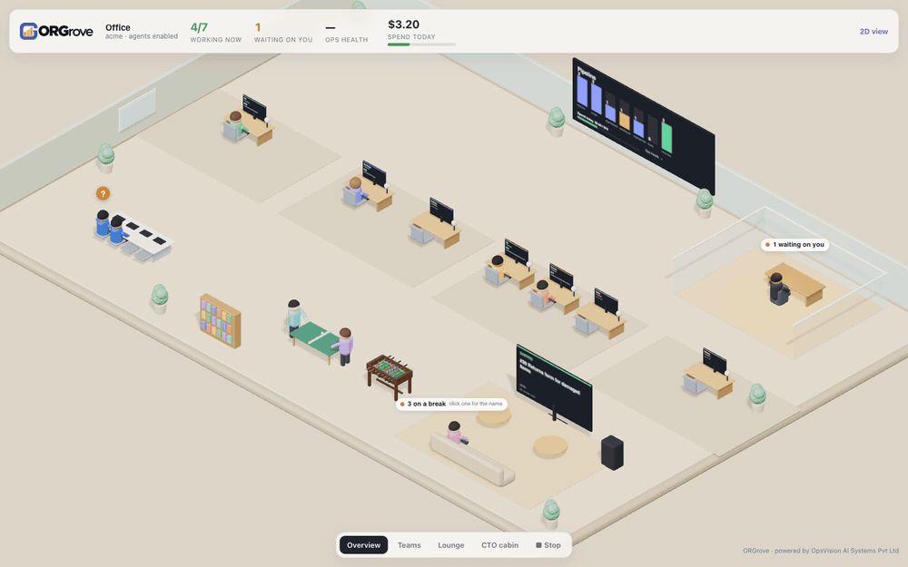

# ORGrove

An AI engineering team that works in your GitHub: a product manager, a developer, QA, Security, DevOps and a
Sanity checker, each an agent with its own job, budget and limits. They plan tickets, write the code, review it
and open a pull request. **A person merges every change.**



*The Office on your own computer, here with a demo project. Who sits at which desk follows real runs, and your own
coding sessions on this computer get desks too.*

- Runs in your own GitHub organisation (GitHub Actions) with your own Anthropic API key.
- Hard daily and monthly spending caps, enforced before any run starts.
- Reviewers can only read; protected files and your forbidden list are refused whatever a ticket says.
- The Office (`bin/orgrove-office`) shows the team at work, live from GitHub, on your own computer.
- **What it costs:** your own Anthropic key and GitHub Actions minutes, about $1 for a small ticket, under caps you
  set. No account with us, and no telemetry.

## Install

You need a GitHub organisation you own, Python 3.11 or newer, git, the GitHub CLI (`gh`, logged in) and an
Anthropic API key with a monthly spend limit. It works on macOS and Linux (with gh 2.40 or newer). Then:

```sh
git clone https://github.com/ORGrove/orgrove
cd orgrove
./install
```

(Or download the ZIP from GitHub, unpack it, and run `./install` in that folder.) Your install goes to a new
`orgrove` repo in your organisation; the copy you cloned stays linked as `upstream`, for updates.

`./install` opens a page in your browser and everything happens there. Prefer the terminal? `./install --cli`.

On a computer without a browser (a server you reach over SSH), fix the port of the installer page and forward
it: `ssh -L 8790:127.0.0.1:8790 you@server`, then `./install --port 8790` on the server, and open the address it
prints in your own browser.

It asks five things (your organisation, the API key, the project, your spend caps, who may give the agents work)
and does the rest: the repos, the three GitHub Apps (you click Create and Install on GitHub's own pages), the secrets,
the configuration and the checks. If it stops, run it again: it continues where it stopped. **INSTALL.md**
explains what it needs, what it costs and how to fix problems, and lists every step by hand for IT teams.

## Using ORGrove

1. **Open an issue** in your project repo, as one of the people you named during the install, saying what you
   want and how you will know it works.
2. **Watch it move.** The PM plans it in a comment, Dev builds it, QA and Security review it. Its label shows
   the stage, and `bin/orgrove-office` shows the whole team live. If an agent needs a decision, the issue is
   labelled `needs/human`: answer in a comment.
3. **Merge the pull request** when it arrives. Only a person merges.

**GUIDE.md** explains each step: how to write a good issue, what every label means, where to watch, how to hold
or stop the agents, and what a ticket costs.

## Author

Questions or ideas: [GitHub Discussions](https://github.com/ORGrove/orgrove/discussions).

ORGrove is made by **OpsVision AI Systems Pvt Ltd**. See `AUTHORS`.
